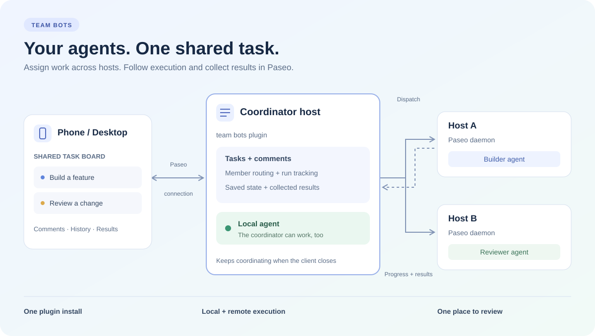
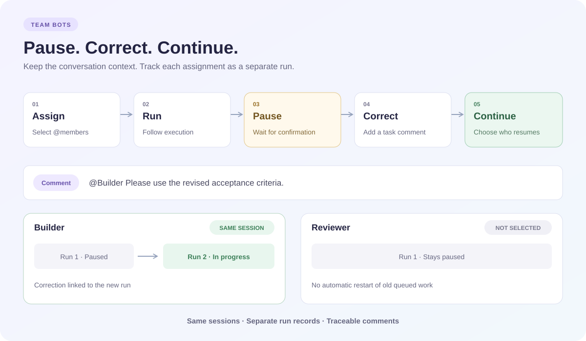
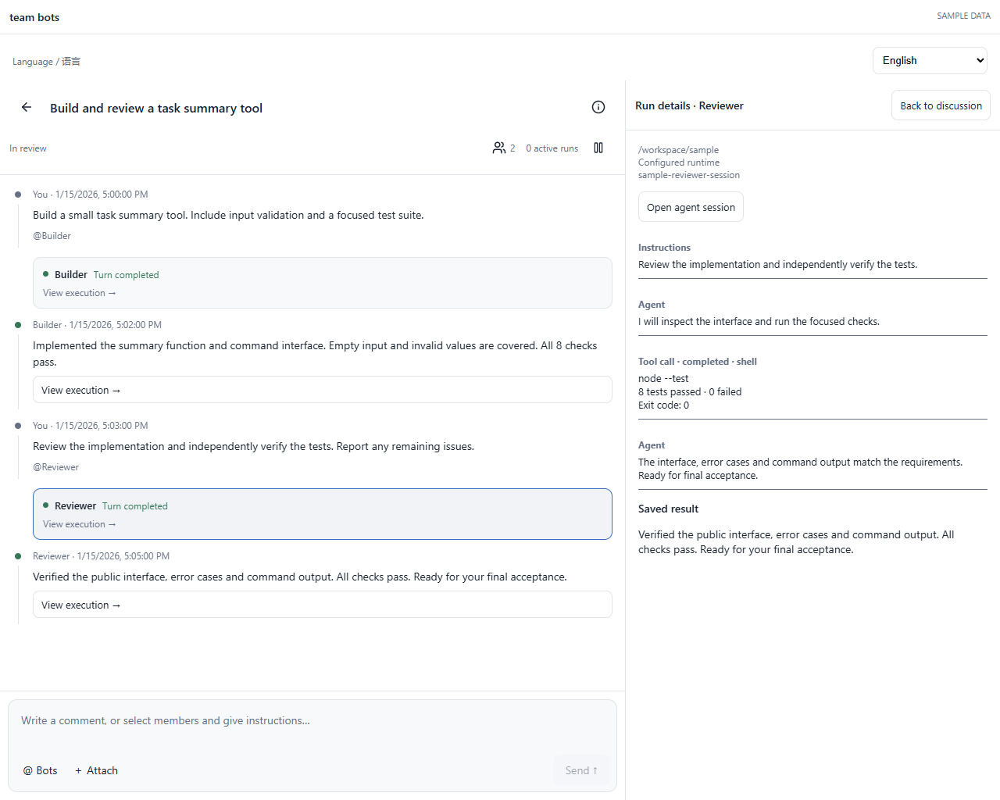

# team bots

[English](README.md) · [简体中文](README.zh-CN.md)

**One task board for agents across your Paseo hosts.**

A [Paseo](https://paseo.sh) plugin for assigning work, following execution, and collecting results across machines. Install it on one coordinator host and work with the team from your phone or desktop. The coordinator can also participate in local execution.



_Illustration only. Roles, hosts, and task labels are fictional._

## Features

- **Shared task board:** To do → In progress → Blocked / In review → Done.
- **Named bots:** associate each bot with a host, runtime, explicit model, role instructions, and default directory. One host can have several bots.
- **Discussion timeline:** compact execution cards follow their triggering comments; expand long replies inline. Execution details open alongside discussion on wide screens or fill the plugin area on narrow screens. Returning preserves the draft, expanded replies, and reading position.
- **Compact task controls:** icon actions leave space for the title. Hover or focus to read a hint; on touch screens, long-press for the hint without executing the action.
- **Comment to assign:** select `@members` and send instructions. Comments without recipients remain discussion.
- **Assignment settings:** under Bots → Settings, limit bots per comment (8 by default) or choose Unlimited. This setting is saved on the coordinator and does not control concurrency or queuing.
- **Persistent sessions:** continue the same member's session within a task; create it automatically on first assignment.
- **Execution history:** view messages, tool activity, permission requests, and saved results, including after completion.
- **Pause and correct:** freeze dispatch, confirm interruption, add a correction, and continue only selected members.
- **Projects and attachments:** select each host's Paseo project and attach text, Markdown, or images to comments.
- **English and Chinese:** choose System, English, or 简体中文. User content and agent output retain their original language.

## How it works

The client uses its existing Paseo connection to the coordinator. The plugin backend connects to execution hosts, saves task/run associations, and collects results. Closing the client does not stop coordination.

No separate coordination service or remote copy of this plugin is required. The coordinator needs its own authorized connections to execution hosts; pairing them with your phone alone does not grant it access. Relay pairing is supported, so SSH is not required.



_Every assignment has its own run record and triggering comment. Continuing a session preserves its conversation context._

## Install

Install directly from the public Git repository on the coordinator:

```sh
paseo plugin add git:yeyan00/paseo-bots --ref v0.1.0
```

The manifest prepares locked production dependencies with lifecycle scripts disabled. Registry listing submission is separate from direct Git installation.

Requirements: Paseo **0.11.4 or later** with plugins enabled on the coordinator, plus Node.js and npm. Each execution host needs a running Paseo daemon and an authenticated, usable agent runtime. Tested with Paseo 0.11.4.

Clone this repository **onto the coordinator host**:

```sh
git clone https://github.com/yeyan00/paseo-bots.git
cd paseo-bots
npm ci
npm exec -- tsx server/install.ts
```

The script installs or reloads the plugin through the local running daemon without restarting it. Open **team bots** in the Paseo sidebar on a compatible client connected to that host. The package/plugin ID remains `paseo-team-tasks`.

## Set up your team



The listing screenshots use the real plugin components with fictional data and simulated host responses; no live host, project or model information is included. See [release verification](docs/release-verification.md) for validation scope.
1. In **Bots → Hosts**, add an execution host using its Paseo Relay pairing link. The coordinator's own host is already available.
2. In **Bots**, add bots and choose their host, runtime, explicit model, default directory, and instructions.
3. In **Bots → Projects & directories**, add a collaboration project and select the corresponding Paseo project on each participating host. The picker can register an existing directory or create a new host project.
4. Create a task with a goal and acceptance criteria, then choose its project.
5. Write instructions in the bottom composer, choose **@ Bots**, and send. Select an execution card to inspect progress, or use the task header to find each bot's latest run.
6. Verify actual deliverables before marking the task Done.

A task's project determines its directory on each host; without a project, the member's default directory is used. Existing runs retain their original directory. Project associations **do not synchronize files**.

## Comments and execution

| Action                             | Behavior                                                                                                  |
| ---------------------------------- | --------------------------------------------------------------------------------------------------------- |
| Comment without members            | Save discussion; do not message an agent.                                                                 |
| First assignment to a member       | Automatically create its task session.                                                                    |
| Assign the same member again       | Continue the session with a new run linked to this comment.                                               |
| Assign while the member is running | Queue the instruction until the preceding turn finishes.                                                  |
| Pause task                         | Freeze dispatch and request interruption; queued assignments stay paused.                                 |
| Continue & send                    | Continue selected members with the correction; unselected members and old queued assignments stay paused. |
| Stop one run                       | Interrupt that run; other queued work can still proceed.                                                  |

The task remains **Pausing** until interruption is confirmed, including when a host is offline. Changing a board status does not resume execution. Marking a task Done requires active runs to have finished or confirmed interruption.

Changing a member's host, runtime/model, or actual directory uses a separate session for that configuration. An unavailable remote session produces an error rather than silently replacing its context. Stopping preserves history and files; it does not undo edits or guarantee termination of detached background processes.

## Attachments and history

Desktop/web supports UTF-8 text, Markdown, JSON, CSV, YAML, logs, and PNG/JPEG/WebP/GIF: **4 attachments per comment, up to 512 KB each**. Files are stored on the coordinator and uploaded with the assignment. Old attachments are not automatically resent.

Native mobile clients can preview attachments and create text attachments by pasting content. Device file and photo selection is not yet supported by this SDK integration.

History loads from the execution host in pages of up to 80 entries, with older entries available on demand. Saved final replies remain on the coordinator; original history requires the execution host online. Opening a remote native agent page also requires a direct client connection to that host.

## Persistence and recovery

Data lives in `$PASEO_HOME/team-tasks`, or `~/.paseo/team-tasks` when `PASEO_HOME` is unset. Override it with `PASEO_TEAM_HOME`.
- `state.json`: tasks, comments, member/project settings, run mappings, and results.
- `connections.json`: private remote connection configuration.
- `attachments/`: comment files.

Runs are saved before dispatch. Creation uses a stable idempotency key, and plugin restarts reconcile existing mappings. Uncertain continuation delivery is checked against session history rather than blindly resent.

Use **one coordinator plugin instance per data directory**. Work in the same host directory is serialized; different hosts can run concurrently. When the coordinator is offline, running remote agents can continue, while dispatch and result collection wait for recovery.

Plugins are trusted code running with the daemon user's permissions. Keep credentials and live task data out of source control. Automatic leader loops, DAG scheduling, Git merging, and general artifact synchronization are outside the current scope.

## Development

```sh
npm run format
npm run typecheck
npm run lint
npm test
```

Tests are scoped to the store/coordinator test files. Reload after source changes with `npm exec -- tsx server/install.ts`.

The CLI calls the installed plugin without starting another coordinator:

```sh
npm run team -- help
npm run team -- snapshot
npm run team -- create task.json
npm run team -- comment comment.json
npm run team -- pause <taskId>
npm run team -- timeline <runId>
```

Example assignment using configured member IDs:

```json
{
  "requestId": "instruction-001",
  "taskId": "task-example",
  "body": "Implement the agreed change and report verification results.",
  "memberIds": ["builder", "reviewer"]
}
```

Keep `requestId` unchanged when retrying a request. After confirmed interruption, add `"resumeTask": true` to explicitly continue a paused task.

## License

[Apache-2.0](LICENSE).
